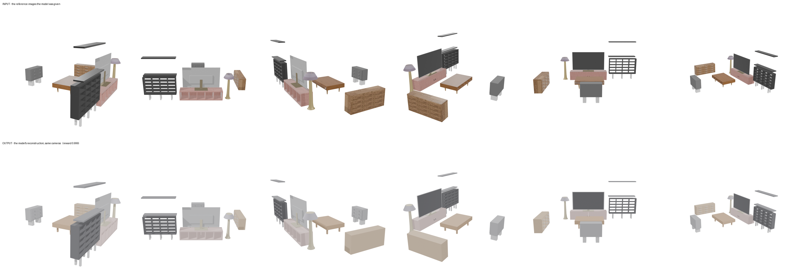
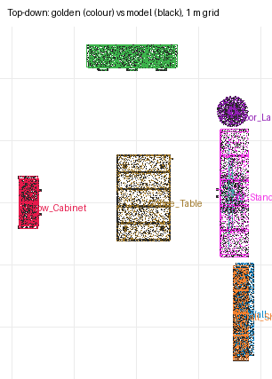

# recon-den — cursor/glm-5p3-flash (cursor-cli)

**Reward: 0.999** (per-object F@5%, average over golden items) · golden solution: 1.000

| Run | |
|---|---|
| Steps | ? (stopped on its own: ?) |
| Time | ? s |
| Whole-room F@5% | 1.00 (precision 1.00, recall 1.00) |

| Item | F@5% | Precision | Recall |
|---|---|---|---|
| Low_Cabinet | 1.00 | 1.00 | 1.00 |
| Sideboard | 1.00 | 1.00 | 1.00 |
| Wall_Shelves | 1.00 | 1.00 | 1.00 |
| Tall_Shelf | 1.00 | 1.00 | 1.00 |
| Floor_Lamp | 1.00 | 1.00 | 0.99 |
| TV | 1.00 | 1.00 | 1.00 |
| TV_Stand | 1.00 | 1.00 | 1.00 |
| Coffee_Table | 1.00 | 1.00 | 1.00 |

