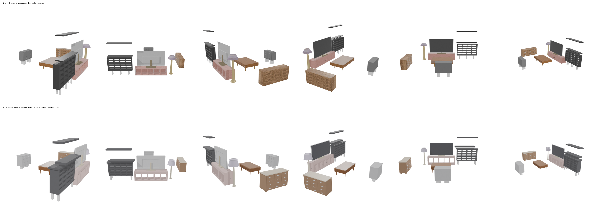
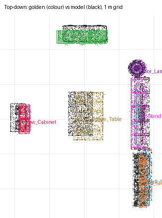

# recon-den — cursor/glm-5p3-flash (cursor-cli)

**Reward: 0.757** (per-object F@5%, average over golden items) · golden solution: 1.000

| Run | |
|---|---|
| Steps | ? (stopped on its own: ?) |
| Time | ? s |
| Whole-room F@5% | 1.00 (precision 1.00, recall 1.00) |

| Item | F@5% | Precision | Recall |
|---|---|---|---|
| Low_Cabinet | 0.68 | 0.82 | 0.58 |
| Sideboard | 0.78 | 1.00 | 0.64 |
| Wall_Shelves | 0.74 | 0.67 | 0.84 |
| Tall_Shelf | 0.86 | 0.84 | 0.89 |
| Floor_Lamp | 0.62 | 0.72 | 0.54 |
| TV | 0.70 | 0.62 | 0.80 |
| TV_Stand | 0.91 | 0.90 | 0.91 |
| Coffee_Table | 0.77 | 0.95 | 0.64 |

