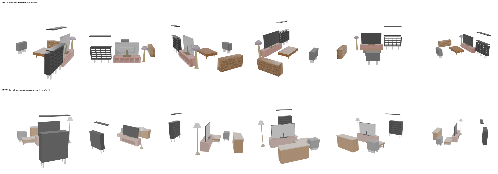
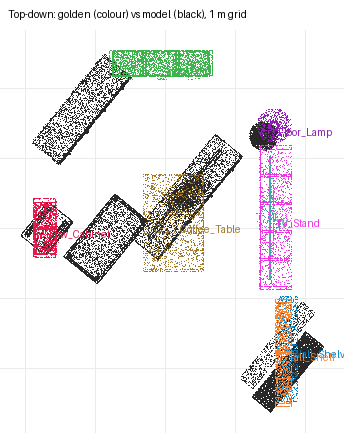

# recon-den — moonshotai/kimi-k3 (sceneactbench-agent)

**Reward: 0.199** (per-object F@5%, average over golden items) · golden solution: 1.000

| Run | |
|---|---|
| Steps | 35 (stopped on its own: False) |
| Time | 1264.3 s |
| Whole-room F@5% | 0.60 (precision 0.72, recall 0.52) |

| Item | F@5% | Precision | Recall |
|---|---|---|---|
| Low_Cabinet | 0.02 | 0.02 | 0.06 |
| Sideboard | 0.33 | 0.44 | 0.27 |
| Wall_Shelves | 0.30 | 0.28 | 0.32 |
| Tall_Shelf | 0.41 | 0.40 | 0.43 |
| Floor_Lamp | 0.22 | 0.20 | 0.24 |
| TV | 0.00 | 0.00 | 0.00 |
| TV_Stand | 0.00 | 0.02 | 0.00 |
| Coffee_Table | 0.30 | 0.30 | 0.30 |

