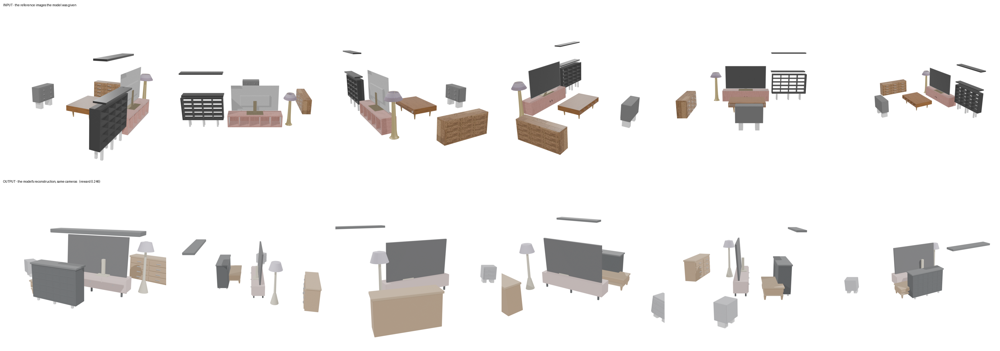
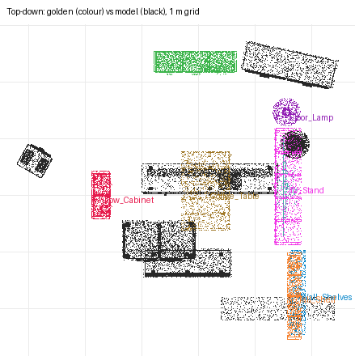

# recon-den — moonshotai/kimi-k3 (sceneactbench-agent)

**Reward: 0.246** (per-object F@5%, average over golden items) · golden solution: 1.000

| Run | |
|---|---|
| Steps | 35 (stopped on its own: False) |
| Time | 1819.0 s |
| Whole-room F@5% | 0.61 (precision 0.80, recall 0.49) |

| Item | F@5% | Precision | Recall |
|---|---|---|---|
| Low_Cabinet | 0.34 | 0.34 | 0.35 |
| Sideboard | 0.00 | 0.00 | 0.00 |
| Wall_Shelves | 0.29 | 0.80 | 0.18 |
| Tall_Shelf | 0.16 | 0.73 | 0.09 |
| Floor_Lamp | 0.00 | 0.00 | 0.00 |
| TV | 0.39 | 0.49 | 0.33 |
| TV_Stand | 0.50 | 0.54 | 0.46 |
| Coffee_Table | 0.29 | 0.23 | 0.41 |

