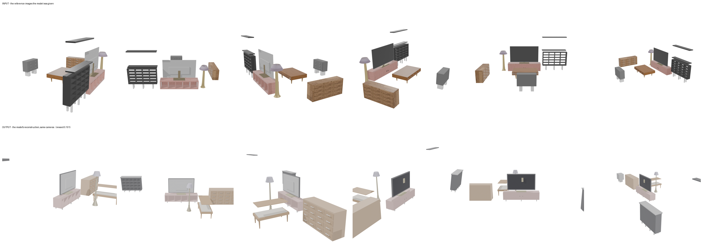
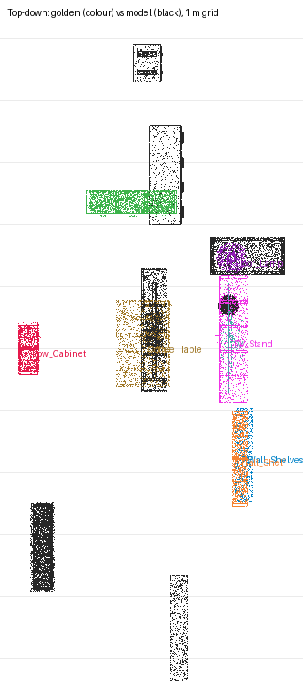

# recon-den — moonshotai/kimi-k3 (sceneactbench-agent)

**Reward: 0.101** (per-object F@5%, average over golden items) · golden solution: 1.000

| Run | |
|---|---|
| Steps | 35 (stopped on its own: False) |
| Time | 1407.2 s |
| Whole-room F@5% | 0.51 (precision 0.82, recall 0.37) |

| Item | F@5% | Precision | Recall |
|---|---|---|---|
| Low_Cabinet | 0.00 | 0.00 | 0.00 |
| Sideboard | 0.34 | 0.52 | 0.25 |
| Wall_Shelves | 0.00 | 0.00 | 0.00 |
| Tall_Shelf | 0.02 | 0.02 | 0.04 |
| Floor_Lamp | 0.00 | 0.00 | 0.00 |
| TV | 0.01 | 0.85 | 0.01 |
| TV_Stand | 0.14 | 0.17 | 0.13 |
| Coffee_Table | 0.29 | 0.24 | 0.35 |

