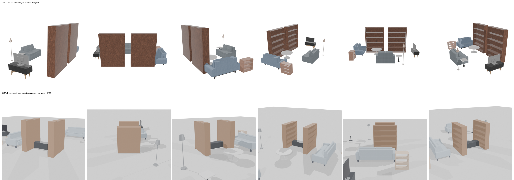

# recon-sitting-room — moonshotai/kimi-k3 (sceneactbench-agent)

**Reward: 0.188** (per-object F@5%, average over golden items) · golden solution: 1.000

| Run | |
|---|---|
| Steps | 35 (stopped on its own: False) |
| Time | 1032.1 s |
| Whole-room F@5% | 0.62 (precision 0.95, recall 0.46) |

| Item | F@5% | Precision | Recall |
|---|---|---|---|
| Bookcase_2 | 0.18 | 0.34 | 0.12 |
| Bookcase_1 | 0.14 | 0.26 | 0.10 |
| Cabinet | 0.10 | 0.09 | 0.12 |
| Floor_Lamp | 0.09 | 0.07 | 0.14 |
| TV | 0.00 | 0.00 | 0.00 |
| TV_Stand | 0.00 | 0.00 | 0.00 |
| Side_Table | 0.03 | 0.03 | 0.04 |
| Coffee_Table | 0.73 | 0.92 | 0.60 |
| Sofa_2 | 0.39 | 0.45 | 0.34 |
| Sofa_1 | 0.23 | 0.25 | 0.20 |

