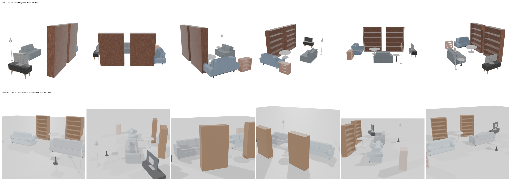
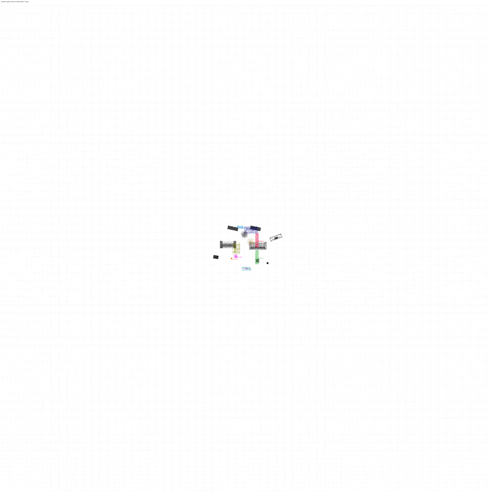

# recon-sitting-room — moonshotai/kimi-k3 (sceneactbench-agent)

**Reward: 0.188** (per-object F@5%, average over golden items) · golden solution: 1.000

| Run | |
|---|---|
| Steps | 35 (stopped on its own: False) |
| Time | 1506.2 s |
| Whole-room F@5% | 0.64 (precision 0.95, recall 0.48) |

| Item | F@5% | Precision | Recall |
|---|---|---|---|
| Bookcase_2 | 0.19 | 0.30 | 0.14 |
| Bookcase_1 | 0.10 | 0.17 | 0.08 |
| Cabinet | 0.10 | 0.09 | 0.12 |
| Floor_Lamp | 0.03 | 0.05 | 0.03 |
| TV | 0.00 | 0.00 | 0.00 |
| TV_Stand | 0.00 | 0.00 | 0.00 |
| Side_Table | 0.01 | 0.01 | 0.02 |
| Coffee_Table | 0.74 | 0.82 | 0.67 |
| Sofa_2 | 0.43 | 0.43 | 0.42 |
| Sofa_1 | 0.27 | 0.31 | 0.25 |

