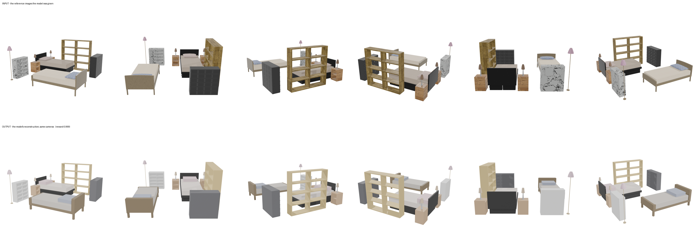
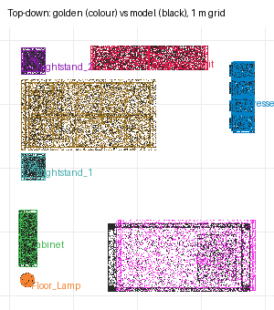

# recon-twin-bedroom — cursor/glm-5p3-flash (cursor-cli)

**Reward: 0.999** (per-object F@5%, average over golden items) · golden solution: 1.000

| Run | |
|---|---|
| Steps | ? (stopped on its own: ?) |
| Time | ? s |
| Whole-room F@5% | 1.00 (precision 1.00, recall 1.00) |

| Item | F@5% | Precision | Recall |
|---|---|---|---|
| Shelving_Unit | 1.00 | 1.00 | 1.00 |
| Cabinet | 0.99 | 0.99 | 1.00 |
| Dresser | 1.00 | 1.00 | 1.00 |
| Floor_Lamp | 1.00 | 1.00 | 1.00 |
| Nightstand_2 | 1.00 | 1.00 | 1.00 |
| Nightstand_1 | 1.00 | 1.00 | 1.00 |
| Bed_2 | 1.00 | 0.99 | 1.00 |
| Bed_1 | 1.00 | 1.00 | 1.00 |

