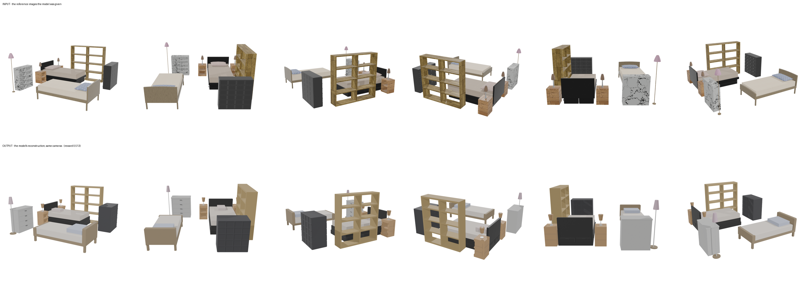
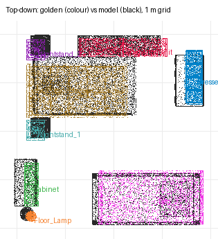

# recon-twin-bedroom — cursor/glm-5p3-flash (cursor-cli)

**Reward: 0.513** (per-object F@5%, average over golden items) · golden solution: 1.000

| Run | |
|---|---|
| Steps | ? (stopped on its own: ?) |
| Time | ? s |
| Whole-room F@5% | 0.98 (precision 0.99, recall 0.97) |

| Item | F@5% | Precision | Recall |
|---|---|---|---|
| Shelving_Unit | 0.94 | 0.96 | 0.91 |
| Cabinet | 0.23 | 0.15 | 0.54 |
| Dresser | 0.16 | 0.11 | 0.33 |
| Floor_Lamp | 0.35 | 0.47 | 0.28 |
| Nightstand_2 | 0.28 | 0.30 | 0.25 |
| Nightstand_1 | 0.34 | 0.36 | 0.32 |
| Bed_2 | 0.98 | 0.97 | 1.00 |
| Bed_1 | 0.83 | 0.81 | 0.84 |

