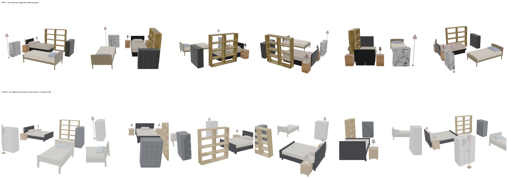
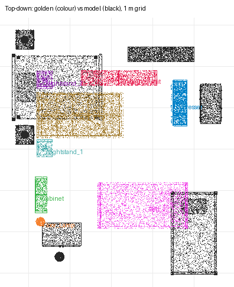

# recon-twin-bedroom — moonshotai/kimi-k3 (sceneactbench-agent)

**Reward: 0.348** (per-object F@5%, average over golden items) · golden solution: 1.000

| Run | |
|---|---|
| Steps | 16 (stopped on its own: True) |
| Time | 1264.9 s |
| Whole-room F@5% | 0.80 (precision 0.94, recall 0.70) |

| Item | F@5% | Precision | Recall |
|---|---|---|---|
| Shelving_Unit | 0.61 | 0.80 | 0.50 |
| Cabinet | 0.00 | 0.00 | 0.00 |
| Dresser | 0.56 | 0.91 | 0.40 |
| Floor_Lamp | 0.00 | 0.00 | 0.00 |
| Nightstand_2 | 0.31 | 0.23 | 0.48 |
| Nightstand_1 | 0.14 | 0.99 | 0.08 |
| Bed_2 | 0.41 | 0.50 | 0.34 |
| Bed_1 | 0.76 | 0.99 | 0.61 |

