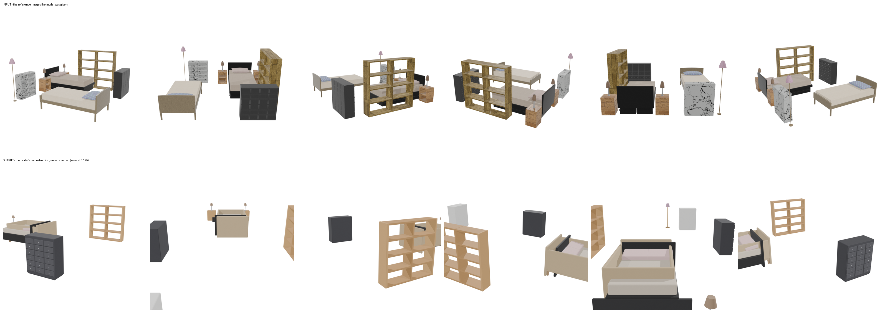
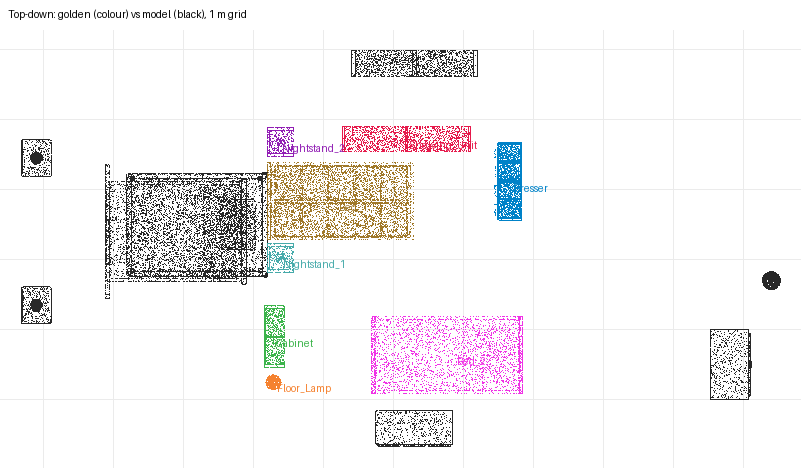

# recon-twin-bedroom — moonshotai/kimi-k3 (sceneactbench-agent)

**Reward: 0.125** (per-object F@5%, average over golden items) · golden solution: 1.000

| Run | |
|---|---|
| Steps | 35 (stopped on its own: False) |
| Time | 1219.6 s |
| Whole-room F@5% | 0.49 (precision 0.88, recall 0.34) |

| Item | F@5% | Precision | Recall |
|---|---|---|---|
| Shelving_Unit | 0.00 | 0.00 | 0.00 |
| Cabinet | 0.00 | 0.00 | 0.00 |
| Dresser | 0.01 | 0.07 | 0.01 |
| Floor_Lamp | 0.00 | 0.00 | 0.00 |
| Nightstand_2 | 0.08 | 0.24 | 0.05 |
| Nightstand_1 | 0.00 | 0.00 | 0.00 |
| Bed_2 | 0.30 | 0.61 | 0.20 |
| Bed_1 | 0.61 | 0.93 | 0.45 |

