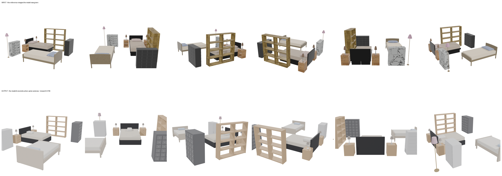
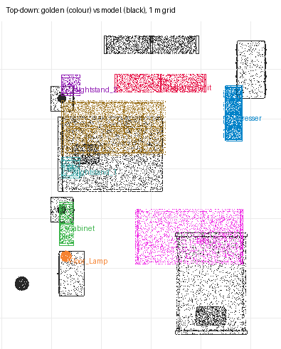

# recon-twin-bedroom — moonshotai/kimi-k3 (sceneactbench-agent)

**Reward: 0.318** (per-object F@5%, average over golden items) · golden solution: 1.000

| Run | |
|---|---|
| Steps | 30 (stopped on its own: True) |
| Time | 1956.7 s |
| Whole-room F@5% | 0.78 (precision 0.95, recall 0.66) |

| Item | F@5% | Precision | Recall |
|---|---|---|---|
| Shelving_Unit | 0.40 | 0.52 | 0.32 |
| Cabinet | 0.20 | 0.39 | 0.13 |
| Dresser | 0.25 | 0.62 | 0.16 |
| Floor_Lamp | 0.00 | 0.00 | 0.00 |
| Nightstand_2 | 0.13 | 0.67 | 0.07 |
| Nightstand_1 | 0.32 | 0.41 | 0.26 |
| Bed_2 | 0.53 | 0.75 | 0.41 |
| Bed_1 | 0.73 | 0.91 | 0.61 |

